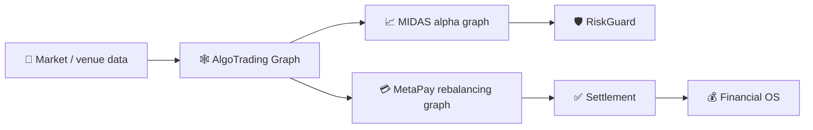

# Algorithmic Trading Graph System

Canonical R&D target for SYNERGY Federation V3 global market/liquidity graph.

## Mission
Build a settlement-aware, capacity-aware graph that can serve two different objectives:

1. **MIDAS alpha discovery** — detect executable pricing cycles/routes.
2. **MetaPay routing** — discover low-cost, reliable payment/rebalancing paths.

These objectives share market/network data but must remain separate optimizers.

## Node model
`Node = (institution, venue, account/channel, asset/currency, settlement_date)`.

## Edge model
`Edge = {rate(Q,t), fee(Q), capacity, min/max size, depth, slippage, latency, settlement_date, timestamp, venue, execution evidence}`.

## Architecture
- adapters: banks, exchanges, brokers, ECNs and supported payment rails;
- symbol/asset normalization;
- order-book normalization;
- settlement-date normalization;
- fee/cost engine;
- graph builder;
- negative-cycle / route candidate discovery;
- exact repricing and sizing;
- shared-edge capacity allocation;
- inventory engine;
- separate rebalancing graph;
- execution simulator;
- alpha half-life recorder;
- evidence/report layer.

## Key invariant
`AlphaGraph != RebalancingGraph`.

Prefunded fast execution is separated from slower SWIFT/SEPA/CIPS/SPFS/bank-transfer rebalancing paths.

## Profitability
Candidate cycle:
`A_C(Q,t) = product(R_e(Q,t)) - 1`.

Portfolio allocation must account for shared edge capacity:
`sum(q_i on edge e) <= Cap_e`.

## Verification status vocabulary
`CANDIDATE → REPRICED → SIMULATED → SHADOW → LIVE_EXECUTED → RECONCILED`.

A positive arithmetic cycle is not a verified arbitrage until actual executable constraints and settlement evidence are satisfied.

## Federation dependencies
- trading intelligence: `Shtenco/midas_ai`;
- payment/rebalancing execution: `Shtenco/synergy_pay_system`;
- accounting truth: `Shtenco/synergy_financial_os`;
- macro/liquidity features: `Shtenco/global_liquidity_dataminer`.

---

# 🧭 Federation passport

Ключевой архитектурный принцип репозитория особенно важен для всей SYNERGY: **AlphaGraph и RebalancingGraph не являются одной и той же задачей оптимизации**.

## Evidence gates

Положительный cycle/route должен проходить минимум:

`CANDIDATE → REPRICED → SIMULATED → SHADOW → LIVE_EXECUTED → RECONCILED`.

На каждом переходе должны сохраняться timestamp, executable quotes, capacity, fee model и evidence.

## Related

- [MIDAS AI](https://github.com/Shtenco/synergy_midas_ai)
- [Pay System](https://github.com/Shtenco/synergy_pay_system)
- [Financial OS](https://github.com/Shtenco/synergy_financial_os)
- [RiskGuard](https://github.com/Shtenco/synergy_riskguard)
- [75-repository atlas](https://github.com/Shtenco/synergy_system/blob/main/docs/SYNERGY_REPOSITORY_ATLAS.md)
