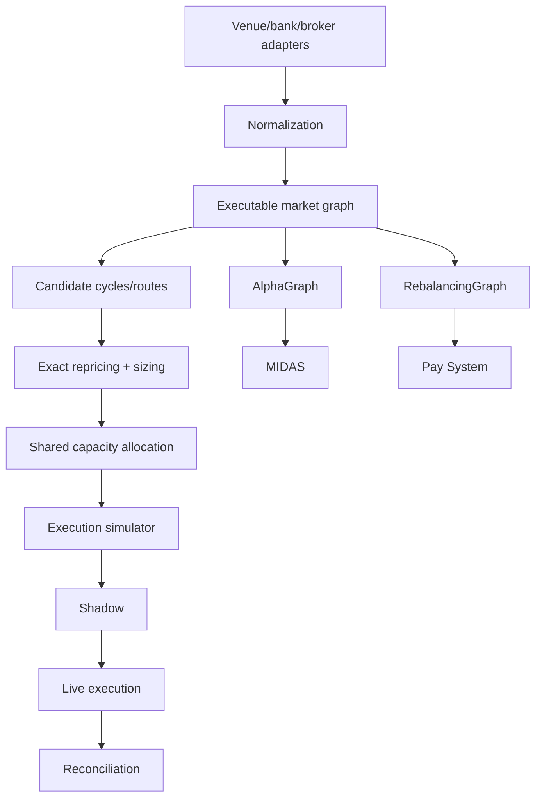

# 🕸️ Algorithmic Trading Graph System — verified R&D specification dossier

> **Статус:** 🧱 STUB / specification-only on current `main`.
> **Проверено по фактическому repository tree:** 29.09.2026.
> **Current reality:** repository contains only `README.md`; no executable graph engine, tests, adapters or datasets are present.

## 1. 🎯 Mission

The target is a settlement-aware, capacity-aware global market/liquidity graph supporting two **separate** optimization problems:

1. MIDAS alpha discovery;
2. MetaPay/payment/rebalancing routing.

The strongest design invariant is:

[
AlphaGraph 
eq RebalancingGraph
]

They may share observations, but have different objectives, latency, funding and settlement constraints.

## 2. 📦 Verified current tree

```text
synergy_algotrading_graph_system/
└── README.md
```

Therefore everything below is a formal target specification, not implemented runtime.

Missing today:

- source package;
- adapters;
- schemas;
- tests;
- CI;
- sample datasets;
- quote capture;
- route engine;
- execution simulator;
- evidence artifacts.

## 3. 🧠 Target node model

Specified node:

[
Node=(institution,venue,account/channel,asset/currency,settlementDate)
]

This is richer than asset-only graph because USD at two venues/accounts/settlement dates is not necessarily fungible at execution time.

## 4. 🔗 Target edge model

Specified edge:

```text
rate(Q,t)
fee(Q)
capacity
min/max size
depth
slippage
latency
settlement_date
timestamp
venue
execution evidence
```

This is the correct direction because a scalar FX rate alone cannot prove arbitrage.

## 5. 💹 Candidate cycle math

For cycle (C):

[
A_C(Q,t)=prod_{ein C}R_e(Q,t)-1
]

But a positive arithmetic value remains only `CANDIDATE`.

It must survive:

- synchronized timestamps;
- exact size Q;
- fees;
- depth/slippage;
- shared capacity;
- settlement;
- inventory/funding;
- latency;
- execution evidence.

## 6. 📦 Shared-edge capacity

For multiple selected routes/cycles:

[
sum_i q_{i,e}le Cap_e
]

Without this constraint, portfolio optimization can double-use the same liquidity.

## 7. 🏗️ Target architecture



## 8. 🚦 Evidence-state vocabulary

Specified lifecycle:

```text
CANDIDATE
→ REPRICED
→ SIMULATED
→ SHADOW
→ LIVE_EXECUTED
→ RECONCILED
```

Current repository itself is **not at CANDIDATE runtime stage** because no engine exists. The vocabulary is target-state semantics.

## 9. 📥 Planned inputs

- L1/L2 quotes;
- bank/ECN/exchange rates;
- fee schedules;
- account balances;
- prefunding;
- settlement calendars;
- transfer rails;
- limits/capacities;
- timestamps;
- latency;
- execution receipts.

## 10. 📤 Planned outputs

Alpha side:

- candidate cycles;
- executable edge after costs;
- max size;
- half-life;
- expected/slippage-adjusted PnL;
- evidence state.

Rebalancing side:

- route;
- expected cost;
- settlement time;
- failure probability;
- capacity consumed;
- transfer evidence.

## 11. 🛡️ Authority boundaries

```text
positive cycle arithmetic != arbitrage
quote != executable fill
capacity estimate != reserved capacity
AlphaGraph != RebalancingGraph
fast trading route != treasury transfer route
simulated profit != realized P&L
LIVE_EXECUTED != RECONCILED
graph state != accounting truth
```

Accounting recognition belongs downstream to Financial OS after settlement evidence.

## 12. ⚠️ Hard technical problems

### Time synchronization
Edges from different timestamps create phantom cycles.

### Settlement mismatch
T+0 vs T+1 assets are not identical nodes.

### Shared liquidity
Multiple routes compete for the same depth.

### Prefunding
A route can be mathematically profitable but unavailable without inventory.

### Leg risk
Sequential fills can destroy a cycle.

### Withdrawal/deposit rails
Exchange conversion profit can be trapped by transfer delays/limits.

### Stale bank quotes
Indicative rates are not executable rates.

## 13. 🧪 Definition of Done: STUB → CANDIDATE

Minimum implementation:

- typed Node/Edge models;
- at least one real/saved adapter dataset;
- timestamp normalization;
- fee model;
- capacity/depth;
- candidate discovery;
- exact repricing;
- deterministic tests;
- evidence output.

Only then may repo claim implemented candidate discovery.

## 14. 🧪 Definition of Done: CANDIDATE → SIMULATED

Need:

- route sizing;
- shared capacity allocation;
- inventory constraints;
- latency model;
- slippage/depth;
- settlement calendar;
- multi-leg failure;
- replay on frozen market snapshot.

## 15. 🧪 Definition of Done: SHADOW → LIVE

Need:

- live synchronized feeds;
- no-order shadow comparison;
- quote-to-fill decay;
- kill switch;
- order idempotency;
- venue-specific limits;
- risk authority;
- immutable audit.

## 16. 🧪 Definition of Done: LIVE → RECONCILED

Need evidence for:

```text
orders
fills
fees
transfers
settlement
balances
accounting entries
realized consolidated P&L
```

Without reconciliation, positive execution logs do not establish economic profit.

## 17. 🛠️ Reproducibility current state

There is no runtime to reproduce.

A factual audit command:

```bash
git clone https://github.com/Shtenco/synergy_algotrading_graph_system.git
cd synergy_algotrading_graph_system
find . -maxdepth 2 -type f
```

will show README as the only project file.

## 18. 🗺️ Current vs target map

| Component | Current |
|---|---|
| formal graph specification | ✅ |
| alpha/rebalancing separation | ✅ documented |
| runtime graph | ❌ |
| adapters | ❌ |
| tests | ❌ |
| CI | ❌ |
| execution evidence | ❌ |
| reconciliation | ❌ |

## 19. 🔗 Federation dependencies

Target integration:

- `synergy_midas_ai` — alpha consumer;
- `synergy_pay_system` — payment/rebalancing consumer;
- `synergy_financial_os` — accounting truth;
- `global_liquidity_dataminer` — macro features;
- `synergy_riskguard` — risk authority;
- `synergy_trademux` — execution.

## 20. 📊 Evidence maturity

```text
Specification              ✅
Repository-specific model  ✅
Executable implementation  ❌
Tests                      ❌
Observed evidence          ❌
Live execution             ❌
Reconciliation             ❌
```

## 21. 🚀 Roadmap

1. typed package;
2. frozen fixture graph;
3. Bellman-Ford/route candidate discovery;
4. exact nonlinear repricing;
5. capacity allocator;
6. AlphaGraph/RebalancingGraph separate objectives;
7. execution simulator;
8. shadow feed;
9. risk/TradeMux link;
10. reconciliation evidence.

## 22. 🛑 Что project НЕ утверждает

- that a global graph is currently implemented;
- that any profitable cycle has been observed;
- that arithmetic negative-cycle detection equals executable arbitrage;
- that payment routes and alpha routes can be merged into one objective;
- that repository is live or production-ready.

---

[🧭 SYNERGY SYSTEM](https://github.com/Shtenco/synergy_system) · [📚 Atlas](https://github.com/Shtenco/synergy_system/blob/main/docs/SYNERGY_REPOSITORY_ATLAS.md)
